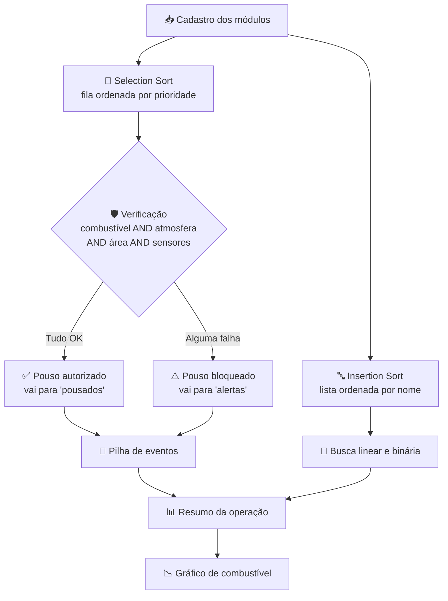

<div align="center">

# 🚀 Aurora SIGER

### Sistema de Gerenciamento de Pouso e Estabilização

*Simulação em Python do controle de pouso de módulos espaciais em uma base marciana*


</div>

> 🎓 **Atividade acadêmica da FIAP**, desenvolvida para o curso de **Ciência da Computação**.
> Tema: *A Aurora Ajusta a Trajetória na Aproximação a Marte* (**MGPEB**).

---

## 📑 Sumário

- [Sobre o projeto](#-sobre-o-projeto)
- [Como o sistema funciona](#-como-o-sistema-funciona)
- [Conceitos aplicados](#-conceitos-aplicados)
- [Dados de entrada](#-dados-de-entrada)
- [Regras de autorização de pouso](#-regras-de-autorização-de-pouso)
- [Modelagem matemática](#-modelagem-matemática)
- [Estrutura do repositório](#-estrutura-do-repositório)
- [Requisitos](#%EF%B8%8F-requisitos)
- [Como executar](#%EF%B8%8F-como-executar)
- [Resultado esperado](#%EF%B8%8F-resultado-esperado)
- [Decisões de projeto](#-decisões-de-projeto)
- [Autores](#-autores)

---

## 📋 Sobre o projeto

Imagine que a nave **Aurora** está se aproximando de Marte e precisa pousar cinco módulos em uma base. Os módulos não podem descer todos de uma vez, e nem todos estão em condições seguras de pouso. O **SIGER** decide **quem desce primeiro** e **quem precisa esperar**, e mantém um histórico de tudo o que aconteceu.

O projeto reúne, em um único cenário, estruturas de dados lineares, algoritmos de ordenação e busca, lógica booleana e modelagem matemática.

**O que o sistema faz:**

1. 📥 Cadastra os módulos (Habitação, Energia, Suporte à Vida, Científico e Logística);
2. 🔢 Organiza a **fila de pouso** por prioridade;
3. 🛡️ Verifica as condições de segurança de cada módulo e **autoriza ou bloqueia** o pouso;
4. 📜 Registra cada decisão em uma **pilha de eventos**;
5. 🔎 Permite **buscar módulos** pelo nome;
6. 📉 Modela o **consumo de combustível** na descida e exibe um gráfico.

---

## 🔄 Como o sistema funciona



O fluxo, passo a passo:

| Etapa | O que acontece | Estrutura / algoritmo |
|:-:|---|---|
| **1** | Os módulos são exibidos em uma tabela | Lista de listas (matriz) |
| **2** | A fila é reordenada, da maior para a menor prioridade | Selection Sort |
| **3** | O sistema processa a fila e decide cada pouso | Fila (FIFO) + lógica AND |
| **4** | Pousados, alertas e fila restante são resumidos | Listas |
| **5** | A pilha mostra o histórico, do evento mais recente ao mais antigo | Pilha (LIFO) |
| **6** | O usuário digita um nome e o módulo é localizado | Busca linear e binária |
| **7** | O consumo de combustível é calculado e plotado | NumPy + Matplotlib |

---

## 🧠 Conceitos aplicados

| Conceito | Aplicação no projeto | Complexidade |
|---|---|---|
| **Fila (FIFO)** | Ordem em que os pousos são processados (`append` para entrar, `pop(0)` para sair) | — |
| **Pilha (LIFO)** | Histórico de eventos, com o mais recente no topo (`append` para empilhar, leitura com `reversed`) | — |
| **Selection Sort** | Ordena a fila por prioridade, de forma decrescente | O(n²) |
| **Insertion Sort** | Ordena os módulos por nome (A → Z), preparando a busca binária | O(n²) no pior caso |
| **Busca linear** | Localiza um módulo na lista original, elemento por elemento | O(n) |
| **Busca binária** | Localiza um módulo na lista ordenada, descartando metade a cada passo | O(log n) |
| **Lógica booleana (AND)** | O pouso só é autorizado se **todas** as condições forem verdadeiras | — |
| **Função linear** | C(t) = C₀ − a·t, consumo de combustível | — |
| **NumPy e Matplotlib** | Cálculo vetorizado e gráfico | — |

---

## 📦 Dados de entrada

Cada módulo é uma **lista** dentro de uma lista maior. Cada posição guarda um campo fixo:

| Índice | Campo | Tipo |
|:-:|---|---|
| 0 | Nome | texto |
| 1 | Prioridade (1 a 5) | inteiro |
| 2 | Combustível (%) | inteiro |
| 3 | Massa (toneladas) | inteiro |
| 4 | Criticidade | inteiro |
| 5 | Horário de chegada | texto |
| 6 | Atmosfera OK | booleano |
| 7 | Área livre | booleano |
| 8 | Sensores OK | booleano |

Os cinco módulos de exemplo:

| Módulo | Prioridade | Combustível | Massa | Criticidade | Chegada | Atmosfera | Área livre | Sensores |
|---|:-:|:-:|:-:|:-:|:-:|:-:|:-:|:-:|
| Habitação | 4 | 85% | 20 t | 4 | 10:00 | ✅ | ✅ | ✅ |
| Energia | 5 | 92% | 15 t | 5 | 10:15 | ✅ | ✅ | ✅ |
| Suporte à Vida | 5 | 80% | 10 t | 5 | 10:30 | ✅ | ❌ | ✅ |
| Científico | 2 | 78% | 12 t | 2 | 10:45 | ✅ | ✅ | ✅ |
| Logística | 3 | 90% | 18 t | 3 | 11:00 | ✅ | ✅ | ❌ |

---

## ✅ Regras de autorização de pouso

Um módulo só pousa se atender **às quatro condições** ao mesmo tempo (porta lógica **AND**):

| # | Condição | Critério |
|:-:|---|---|
| 1 | ⛽ Combustível | **≥ 80%** |
| 2 | 🌫️ Atmosfera | Adequada |
| 3 | 🛬 Área de pouso | Disponível |
| 4 | 📡 Sensores | Íntegros |

Basta **uma** condição falhar para o resultado final ser negativo. Nesse caso, o módulo vai para a lista de **alertas** e o sistema mostra o motivo exato de cada falha.

---

## 📉 Modelagem matemática

O combustível durante a descida é modelado por uma **função afim decrescente**:

```
C(t) = C₀ − a · t
```

| Símbolo | Significado | Valor no projeto |
|:-:|---|:-:|
| C₀ | Combustível inicial | 90% |
| a | Taxa de consumo | 2% por minuto |
| t | Tempo de descida | 0 a 30 minutos |
| C_min | Limite mínimo de segurança | 80% |

O tempo até atingir o limite sai de isolar `t`:

```
t_limite = (C₀ − C_min) / a = (90 − 80) / 2 = 5 minutos
```

O `np.linspace(0, 30, 31)` gera 31 pontos de tempo (0, 1, 2, ..., 30) e a função é aplicada a todos de uma só vez, sem precisar de um laço. O gráfico mostra a reta cruzando a linha tracejada do limite de 80% aos **5 minutos**.

---

## 📁 Estrutura do repositório

```
.
├── mgpeb.py       # Versão em script Python, para rodar no terminal
├── mgpeb.ipynb    # Versão em notebook, com explicações passo a passo
└── README.md      # Este arquivo
```

As duas versões têm a **mesma lógica e produzem os mesmos resultados**. O notebook acrescenta textos explicativos, tabelas de conceitos e uma célula que exibe a lista em ordem alfabética após o Insertion Sort.

---

## ⚙️ Requisitos

- Python 3.8 ou superior
- [NumPy](https://numpy.org/)
- [Matplotlib](https://matplotlib.org/)

No **Google Colab**, NumPy e Matplotlib já vêm instalados, então não é necessário instalar nada. Para rodar o script localmente:

```bash
pip install numpy matplotlib
```

---

## ▶️ Como executar

### Opção 1: Script (terminal)

```bash
python mgpeb.py
```

> 💡 O programa pede o nome de um módulo na etapa de busca. Ao final, abre uma janela com o gráfico e só termina depois que ela for fechada.

### Opção 2: Notebook (Google Colab)

1. Acesse [colab.research.google.com](https://colab.research.google.com/);
2. Vá em **Arquivo → Fazer upload de notebook** e selecione `mgpeb.ipynb`;
3. Execute as células em ordem (`Shift + Enter`).

### Opção 3: Notebook (local)

```bash
pip install jupyter numpy matplotlib
jupyter notebook mgpeb.ipynb
```

### Dicas para a etapa de busca

A busca ignora diferenças entre maiúsculas e minúsculas, então todas estas entradas funcionam:

| Digite | Resultado |
|---|---|
| `energia` | ✅ Encontra Energia |
| `LOGÍSTICA` | ✅ Encontra Logística |
| `suporte à vida` | ✅ Encontra Suporte à Vida |
| `xyz` | ❌ "Módulo não encontrado." |

> ⚠️ A busca considera os **acentos**. Digitar `logistica` (sem acento) não encontra `Logística`.

---

## 🖥️ Resultado esperado

Com os dados de exemplo, a fila fica ordenada por prioridade e o processamento segue essa ordem:

| Ordem | Módulo | Prioridade | Resultado | Motivo |
|:-:|---|:-:|---|---|
| 1 | Energia | 5 | ✅ Pouso autorizado | Todas as condições atendidas |
| 2 | Suporte à Vida | 5 | ⚠️ Alerta | Área de pouso indisponível |
| 3 | Habitação | 4 | ✅ Pouso autorizado | Todas as condições atendidas |
| 4 | Logística | 3 | ⚠️ Alerta | Sensores comprometidos |
| 5 | Científico | 2 | ⚠️ Alerta | Combustível de 78% (abaixo de 80%) |

**Resumo:** 2 módulos pousam (Energia e Habitação), 3 ficam em alerta (Suporte à Vida, Logística e Científico) e a fila termina vazia.

A **pilha de eventos** termina assim, com o evento mais recente no topo:

```
TOPO  → Científico: pouso não autorizado
        Logística: pouso não autorizado
        Habitação: pouso autorizado
        Suporte à Vida: pouso não autorizado
BASE  → Energia: pouso autorizado
```

<details>
<summary><b>📺 Ver exemplo de saída no terminal (trecho)</b></summary>

```
[ 3 ] PROCESSAMENTO DOS POUSOS
----------------------------------------------------------------

[2/5] Suporte à Vida
  Combustível........ OK
  Atmosfera.......... OK
  Área de pouso...... INDISPONÍVEL
  Sensores........... OK
  >> POUSO NÃO AUTORIZADO
  >> ALERTA: Área de pouso indisponível

[5/5] Científico
  Combustível........ INSUFICIENTE
  Atmosfera.......... OK
  Área de pouso...... OK
  Sensores........... OK
  >> POUSO NÃO AUTORIZADO
  >> ALERTA: Combustível insuficiente

[ 7 ] MODELAGEM MATEMÁTICA
----------------------------------------------------------------
Combustível inicial: 90%
Consumo por minuto: 2%
Limite Mínimo: 80%
Tempo até atingir o limite: 5.0 minutos
```

</details>

---

## 🧩 Decisões de projeto

Algumas escolhas que valem ser explicadas:

- **Por que o Selection Sort não é estável?** Energia e Suporte à Vida têm a mesma prioridade (5). Como o algoritmo faz trocas à distância, a ordem entre elementos iguais pode mudar. Aqui, ambos continuam nas duas primeiras posições, e o resultado final não é afetado.
- **Por que duas listas (`fila_pouso` e `modulos_alfabeticos`)?** A fila precisa estar ordenada por **prioridade** e a busca binária exige a lista ordenada por **nome**. Uma mesma lista não pode ter as duas ordens ao mesmo tempo, então cada estrutura tem a sua cópia.
- **Por que `casefold()` e não `lower()`?** Ele compara textos ignorando maiúsculas e minúsculas de forma mais completa e funciona bem com caracteres acentuados.
- **Por que `pop(0)` para a fila?** Remove e devolve o primeiro elemento, que é exatamente o comportamento FIFO. É simples e adequado para cinco módulos. Em um sistema grande, `collections.deque` seria mais eficiente.

---

## 👤 Autores

Desenvolvido pelos integrantes:

| Nome | RM |
|---|---|
| Henrique Floriano Alcantara | 575651 |
| Katia Regina Bispo | 576044 |
| João Pedro Candido Souza | 575884 |
| Nicolas Klai de de França | 575343 |
| Yago Souza Araujo | 575200 |

---

<div align="center">

*Feito com 🐍 Python e muito café, rumo a Marte 🔴*

</div>